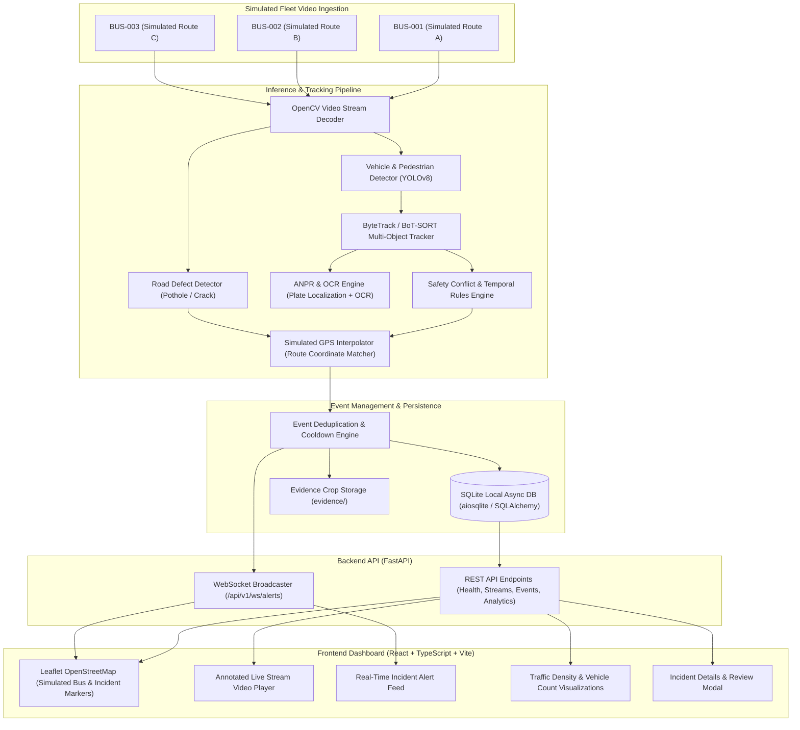

# AI Urban Intelligence Platform (SIH Problem Statement SIH26124)
## Phase 0: System Environment Audit & Architecture Plan

---

### 1. Hardware & System Audit Results

| Component | Detected Specification | Status |
| :--- | :--- | :--- |
| **Operating System** | Windows 11 (64-bit AMD64) | Verified |
| **Host Workspace** | `G:\major project` | Initialized (`git init` executed) |
| **Python Runtime** | Python 3.11.5 (64-bit) | Verified |
| **CUDA & GPU** | **NVIDIA GeForce RTX 4050 Laptop GPU** (6141 MiB VRAM) | **Hardware Detected & Enabled** |
| **NVIDIA Driver** | 616.64 (Supports CUDA 12.x / 13.x) | Verified |
| **PyTorch & CUDA** | `torch 2.5.1+cu121`, `torchvision 0.20.1+cu121` | **Active GPU Acceleration Verified (`torch.cuda.is_available() == True`)** |
| **OpenCV** | OpenCV 5.0.0 (`cv2`) | Verified |
| **Node.js & npm** | Node.js `v24.19.0`, npm `11.17.0` | Verified |
| **Version Control** | Git `2.53.0.windows.2` | Initialized |
| **OCR Cache** | EasyOCR weights cached at `C:\Users\nihar\.EasyOCR\model` | Ready for offline ANPR |

---

### 2. Dataset Audit & Plan

- **Current Status**: The user confirmed that the road defects dataset has not yet been downloaded.
- **Audit Findings**:
  - The repository directory was initialized clean.
  - No existing annotation files or image directories are present in the workspace.
- **Dataset Strategy for Road Defect Detection**:
  - Standard SIH/Smart Cities datasets typically include:
    1. **RDD2020 / RDD2022 (Road Damage Dataset)**: Contains D00 (linear cracks), D10 (longitudinal cracks), D20 (alligator cracks), D40 (potholes/manholes).
    2. **Roboflow Pothole / Road Hazard Datasets**: Typically annotated in YOLO format (`images/train`, `labels/train`, `data.yaml`) with classes such as `pothole`, `crack`, `waterlogging`.
  - **Modular Decoupling**: The backend is architected with a decoupled `RoadDefectDetector` interface.
    - When fine-tuned weights (`models/road_defects_best.pt`) are present, it performs inference on potholes and cracks.
    - When weights are not yet present, the system cleanly reports `"status": "model_missing", "message": "Road defect model not loaded"` or switches gracefully to fallback/pretrained vehicle detection without crashing or fabricating fake detections.
  - **Dataset Ingestion Script**: A dedicated validation script (`scripts/audit_dataset.py`) will be provided to inspect class distributions, label format (YOLO vs Pascal VOC vs COCO), image resolutions, and bounding box sanity checks once the dataset is downloaded.

---

### 3. Architecture Blueprint

---

### 4. Safety & Review Guidelines (Compliance with Problem Statement)
1. **Candidate Events, Not Automatic Convictions**: All detected safety conflicts (e.g. potential proximity alerts, reckless driving candidates) are flagged as **`CANDIDATE_FOR_REVIEW`** with a confidence score and explainable temporal metrics.
2. **Number Plate Uncertainty**: Plates with low OCR confidence or partial character matches are flagged as **`NEEDS_VERIFICATION`** and never reported as confirmed identity.
3. **Simulated Coordinates**: All coordinates are explicitly flagged with `is_simulated_gps: true` and labeled **`SIMULATED GPS`** on the UI.
4. **Graceful Model Handling**: If specific defect models are unavailable, the UI clearly shows the detector as offline rather than generating synthetic hallucinations.

---

### 5. Implementation Roadmap
- **Phase 0**: Environment audit, directory initialization, project skeleton, and architecture verification *(Completed)*.
- **Phase 1**: Backend foundation (FastAPI, SQLite async ORM, Pydantic schemas, health & system status endpoints) + Frontend scaffold (Vite, React, TypeScript, modern dark dashboard theme).
- **Phase 2**: End-to-end vertical slice (video ingestion, frame processing, detection execution, event persistence, and live dashboard rendering).
- **Phase 3**: Multi-stream fleet tracking (BUS-001, BUS-002, BUS-003), vehicle counting, and cooldown deduplication.
- **Phase 4**: Route interpolation, Leaflet map with live vehicle markers, and WebSocket notifications.
- **Phase 5**: Dataset ingestion script, format validation, and defect model training/integration.
- **Phase 6**: ANPR number-plate localization, OCR integration, and safety conflict heuristics.
- **Phase 7**: Automated pytest suite, performance profiling (FPS & latency), and documentation.
